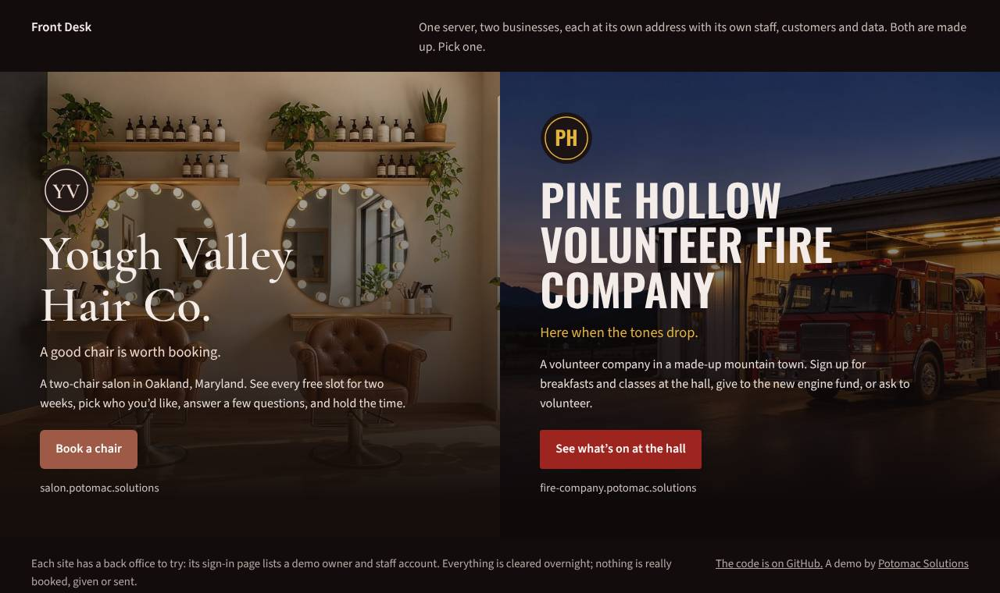

# Front Desk and Community

For the businesses and groups whose website is mostly a front desk: book an appointment, fill in a form, see what's on, sign up, give. Lawyers, insurance agents, accountants, salons and barbers, vets and daycares on one side; churches, volunteer fire companies, clubs, youth leagues, museums and libraries on the other. One app: a site switches on the modules it needs. A Potomac Solutions platform, built on the Potomac kit and [Zubra](https://github.com/zubra-js/zubra).

One server runs several businesses, each at its own web address, each with its own data and its own staff. It starts with two, both made up:

- **Yough Valley Hair Co.** in Oakland, Maryland: a two-chair salon. Appointments with intake questions, and a wedding-party enquiry form.
- **Pine Hollow Volunteer Fire Company** in Pine Hollow, Maryland (a made-up town): an events calendar with sign-ups, a fund for a new engine, and forms to volunteer or book the hall.

No appointment, event or gift here is real. Payments are in test mode, and texts and emails aren't sent: the staff page shows each one instead.

## See it live

[](https://potomac-solutions.github.io/front-desk/)

The same server answers at two addresses, and each one is a different business:

| Business | Live site | What to try |
| --- | --- | --- |
| Yough Valley Hair Co. | [salon.potomac.solutions](https://salon.potomac.solutions/) | Book a chair; the back office at `/admin` |
| Pine Hollow Volunteer Fire Company | [fire-company.potomac.solutions](https://fire-company.potomac.solutions/) | Sign up for an event, give to the engine fund; the back office at `/admin` |

Each site's sign-in page lists a demo owner and staff account. Both are cleared overnight.

## Try it

`npm install`, then `npm run demo`: it fills both businesses with made-up history and starts them. The salon gets four months of appointments and two weeks ahead; the fire company gets past events with sign-ups, a year of online gifts and sign-ups for what's ahead. It prints the sign-ins, for this machine only:

| Business | Address | Owner | Staff |
| --- | --- | --- | --- |
| Yough Valley Hair Co. | http://localhost:3000 | `owner@example.com` / `yough-owner-demo` | `jess@example.com` / `yough-staff-demo` |
| Pine Hollow VFC | http://127.0.0.1:3000 | `owner@example.com` / `pine-hollow-owner-demo` | `office@example.com` / `pine-hollow-staff-demo` |

A customer account on both: `riley@example.com` / `front-desk-guest-demo`.

`npm start` alone keeps what's there; with no data it prints a **setup link** for each business's first owner instead. `npm run seed` fills empty businesses, and `npm run seed -- --fresh` starts over.

**Customer accounts** (`/account`, both businesses): sign up, and what you've booked, signed up for or given from this browser joins the account; signed in on another device it's all there, past and cancelled included. **Forgot your password?** sends a one-time link, which lands in the owner's **Outbox** (nothing is really sent).

**The admin** (`/admin`, staff sign-in), with only the parts a business switched on:
- **Overview**: today's appointments, how booked the chairs are this week, takings at typical prices and cancellations (the salon); events ahead, places taken and online giving against the month before (the fire company); the inbox, new accounts, a chart of the last 30 days, what's next and what the staff did.
- **Appointments**: search, filter by when, status, who and service; cancel (the customer is texted); download as CSV. **Events**: ahead and past with places taken, each with its sign-up list (CSV); owners add events. **Giving**: every online gift, as CSV. **Inbox**: forms to mark handled. **Customers**: accounts and what each has booked or given.
- For owners: **Reports** by day, week or month (appointments and takings by service, chair and start time; or giving by period and gift size, and how full each event was), with CSV; **Settings** for the words and prices people see; **Staff**; and the **Outbox**.

The day sheet (`/staff`) is still where the desk works through today.

**The salon**

1. **Book.** Choose **Colour**, then Jess (Marco doesn't do colour), a day and a time. The time is held for you for ten minutes while you answer the colour questions. Colour takes a $25 deposit to book, paid on Clover's page (until Clover is set up, the kit's test page: press **Pay**, or go back without paying and the time is let go). A cut, a beard trim or a kids' cut is booked at once, with nothing to pay.
2. **Watch the times.** In the other window, open the same day: your time is struck out, without a reload. Hold a time in one window and it greys out in the other; **Let this time go** and it's back.
3. **Anyone.** Book a cut with **Anyone**: a time stays open while either chair is free.
4. **The front desk.** Open **Staff** from the footer and sign in as the owner. The day sheet shows each chair's bookings with the answers; cancel one and the time is free again at once. **Texts and emails sent** shows the confirmations that would have gone out.
5. **A form.** Send a wedding-party enquiry; it's in the staff inbox, to mark handled.

**The fire company** (http://127.0.0.1:3000)

1. **Sign up.** Open the CPR class and sign up for three places. The calendar in the other window counts down from 12 to 9, live. Cancel, and they're back.
2. **Give.** Give to the engine fund on PayPal's page (until PayPal is set up, the kit's test page: press **Pay**, or go back without paying). The total on the home page moves in every open window.
3. **Volunteer.** Send the volunteer form; the office sees it in the inbox.

Without JavaScript (turn it off in the browser's settings), all of it works the same.

## Paying

Each business shows off a different platform. The card is typed on the platform's page, never here.

- **The fire company: PayPal.** Gifts to the engine fund go to PayPal and count once PayPal says they're paid. Backing out gives nothing. PayPal takes the money when the customer comes back (or the webhook comes), not on its own page.
- **The salon: Clover.** People pay at their visit, except colour, which takes a $25 deposit online to book. The chair is the customer's while they're on Clover's page, and the appointment is booked once Clover's signed webhook says the deposit is in. Clover has no call to ask about a payment, so coming back before the webhook shows a "Confirming your deposit" page that checks again by itself. Backing out, or leaving the page open for half an hour, lets the time go. Cancelling an appointment gives the deposit back. A deposit that arrives after the time was let go is given back too.

Until a platform's settings are on the server, the kit's test page stands in. It is plainly a test, with no card and no money, and makes the same trip there and back. To use PayPal's test mode for the fire company, set these on Railway:

| Setting | What |
| --- | --- |
| `PAY_PAYPAL_CLIENT`, `PAY_PAYPAL_SECRET` | A sandbox REST app's client id and secret (developer.paypal.com → Apps & Credentials, Sandbox) |
| `PAY_PAYPAL_SANDBOX` | `1` |
| `PAY_PAYPAL_WEBHOOK_ID` | Optional: a webhook for `CHECKOUT.ORDER.APPROVED` and `PAYMENT.CAPTURE.COMPLETED` at `https://fire-company.potomac.solutions/pay/webhook`, and its id |

For Clover's sandbox on the salon:

| Setting | What |
| --- | --- |
| `PAY_CLOVER_MERCHANT` | The sandbox test merchant's id |
| `PAY_CLOVER_KEY` | The Ecommerce private key of a Hosted Checkout integration (sandbox Merchant Dashboard → Ecommerce API tokens) |
| `PAY_CLOVER_WEBHOOK_SECRET` | The signing secret of a Hosted Checkout webhook at `https://salon.potomac.solutions/pay/webhook`. Required: it's the only way the salon learns a deposit is in |
| `PAY_CLOVER_SANDBOX` | `1` |

Which platform each business uses is set in `server.js` (`PLATFORMS`), so `PAY_PROVIDER` has no effect here. Keep the public demo on test keys: with live ones, real money moves. The Clover webhook's signature format is written from Clover's documentation and hasn't been tried against its sandbox yet. Clover only sends customers back to an `https` address, so try it on the deployed site, not on localhost.

`SESSION_SECRET` must be at least 32 characters now (the kit refuses a shorter one).

## How it is put together

| Piece | Job |
| --- | --- |
| Potomac kit (private) | `hold` (each chair's day in 15-minute pieces, held while you fill in the details, then booked, and given back with `free` when cancelled; each event's places, all of a party or none), `pay` (gifts, test provider, charged once), `notify` (confirmations, kept in an outbox here), `staff` (each business's owner and staff: passwords, sessions, invites, resets, roles), `tenant` and `tenancy` (the business from the host name, and its own log), `auth` (guests), `store` (the Sync log) |
| `@zubra/server` | Renders every page before any JavaScript runs |
| `@zubra/sync` | Each business's log (one SQLite file each). Which pieces of each chair are taken, each event's places left and the fund's total are documents only the server writes; pages follow them live, and never read who booked, signed up or gave |
| `src/site.js` | The two sites as data: modules switched on, staff and their hours, services with their questions, events, the fund, and every form's fields |
| `src/desk.js` | The deciding: free times, holds and bookings, sign-ups, gifts, forms against their fields, the inbox, what follows a customer account, the owner's settings and the staff activity |
| `kit/customers`, `kit/reports` | Customer accounts; the numbers by day, week or month, and CSV |
| `src/account.js`, `src/admin.js`, `kit/charts` | The account pages; the admin; charts drawn on the server as SVG, with a table under each |
| `bin/seed.js` | The demo data |
| `free-times`, `places-left`, `fund-progress` | The live parts |

## Run it

```sh
npm install
npm start        # both businesses: the salon at localhost:3000, the fire company at 127.0.0.1:3000
npm test         # needs Chrome or Playwright's Chromium
```

Node 26. `SESSION_SECRET` is required in production, where cookies are `Secure` (and the staff cookie `__Host-`). `DATA_DIR` says where the database files go, one per business. `TENANTS` is the list of businesses, as JSON:

```sh
TENANTS='[{"id":"yough-valley-hair","site":"desk","hosts":["youghvalleyhair.com"]},{"id":"pine-hollow-vfc","site":"community","hosts":["pinehollowvfc.org"]}]'
```

Behind a proxy (Railway, Fly, a load balancer), set `TRUST_PROXIES` to how many add to `X-Forwarded-For` (usually `1`), so a wrong-password lockout falls on the device guessing and not on everyone; left unset, no header is trusted and every sign-in counts as the proxy's address.

A business's setup link is printed at start until it has an owner; each lasts a day, and a restart prints a fresh one. Claim it right after the first deploy: until someone does, anyone who can read the server's log could.

## The public demo

With `DEMO=1` the server is a demo anyone can try, staff side included (`src/demo.js`):

- It runs on the seeded data (`npm run demo` seeds fresh, then serves), so each business's admin, day sheet and reports are full from the first visit.
- Each business's staff sign-in page shows its own sign-ins (the table under **Try it**), and the customer sign-in page shows the customer, who has an account at both.
- Nobody can change a demo account: not its password, roles, name or reset link, and nobody can turn it off. Everything else a visitor does lasts until the reset, including people they invite.
- Once a night at 4 am New York time the server exits, and Railway's "always" restart policy (`railway.json`) starts it again with `npm run demo`: fresh data dated from today, and the same sign-ins. No volume is needed.

## Deploy the demo on Railway

`railway.json` sets the build, the start command, the health check (`/health`) and the restart policy.

1. In Railway, make a service from `Potomac-Solutions/front-desk`, from the `main` branch.
2. Set the service's variables:

   ```sh
   NODE_ENV=production
   SESSION_SECRET=<a long random string: openssl rand -base64 48>
   DEMO=1
   TRUST_PROXIES=1
   TENANTS=[{"id":"yough-valley-hair","site":"desk","hosts":["salon.potomac.solutions"]},{"id":"pine-hollow-vfc","site":"community","hosts":["firehall.potomac.solutions"]}]
   ```

3. Under **Settings → Networking**, add both custom domains, `salon.potomac.solutions` and `firehall.potomac.solutions`. Railway shows a CNAME target for each.
4. At the DNS host for `potomac.solutions`, add the two CNAME records Railway gave (`salon` and `firehall`), and any TXT record it asks for to verify them. Railway issues the certificates once the records resolve.
5. Open each address. Its staff sign-in page shows its demo sign-ins.

For a real business, leave out `DEMO`, set `DATA_DIR` to a mounted volume (the data must outlive a deploy), and claim each setup link from the deploy log straight away.

## What the tests prove

The salon (`test/desk.test.js`):

1. Without JavaScript: a service, a person who does it, a day and a time; held while the questions are answered (each one needed and checked); colour's deposit paid on the test page (standing in for Clover's), then booked, with the confirmation sent. Someone else finds the time taken and can't see or cancel the booking; the front desk sees it with the answers.
2. A held time is nobody else's, nor is a booking that would run into it (one that ends where it begins is fine); choosing another time, or letting go, frees it.
3. Two guests pressing the same time at the same moment: one holds it.
4. Free times are live: holding and letting go show at once on an open page, including the earlier times a long booking would run into; with **Anyone**, a time stays open until both chairs are taken.
5. A hold runs out: someone else may take the time, and the late booking is told; if nobody did, it still books. The sweep writes lapsed holds down for live pages.
6. Cancelling, by the guest or the front desk, frees the time at once and texts the guest; the desk's posts need signing in.
7. Only the times shown can be held: not before opening, past closing, off the quarter hour, on a day off, in the past, with someone who doesn't do the service, or for a service that isn't offered. With **Anyone**, a late cut goes to whoever is still working.
8. A form is checked against its fields (a date, a number in range, an email) and reaches the inbox, to be marked handled.
9. A page reads which times are taken and nothing else, even when it asks: no names, no phone numbers. It writes nothing, another site's post is refused, and the salon has no calendar or giving.
10. Today's times start an hour from now, on the quarter hour, and end by closing.

The fire company (`test/community.test.js`):

1. Without JavaScript: the calendar; an open event needs no sign-up; signing up for places, once; the office sees who's coming; cancelling gives the places back.
2. Places run out: never more than a party's limit or than are left; two parties for the last places at once, one gets in; no place is given twice; a double press signs up once.
3. Places left are live on every open calendar.
4. Giving: backing out of the payment page gives nothing; on PayPal (faked) a gift is approved there and taken once on the way back, and backed out first, PayPal is never told to take it; a gift is charged once even when pressed twice; the total moves live; amounts and names are checked, and a gift's page can't be reused by someone else.
5. The volunteer form needs its tick box and a real choice; the hall form's numbers are checked.
6. A page reads the events and the fund and nothing else; it writes nothing; the fire company has no appointments.

Two businesses on one server, and their staff (`test/accounts.test.js`):

1. Each host gets its own business, matched without case; a host nobody answers to is a 404, pages and live data alike.
2. Each business's first owner sets up from its own setup link, once; a link means nothing at the other business; link pages aren't cached and send no `Referer`. A session at one business is nobody at the other, and the same email can be two different people.
3. An owner invites staff (the link is shown on the page, not put in its address). Staff see the day sheet but can't open or use the owner's pages. Turning someone off ends their open session at once. The last owner can't step down. A reset link sets a new password, and the old one stops working.
4. Five wrong passwords lock that device's address out of the email, even with the right password, and only at that business; behind a proxy, the owner still signs in from her own address. Changing your password signs out your other devices. Signing out ends the session. Another site can't post a sign-in.
5. Each business's live data is its own, and a page that asks for staff accounts, sessions or tokens gets none: no hashes, emails or names.

The demo (`test/demo.test.js`):

1. Every business starts with the demo owner and prints no setup link; the sign-in page shows the login, and it works at both.
2. Nobody can change the demo account (password, roles, reset link, turning it off, ending its sessions), not even an owner a visitor invited; other accounts still can be.
3. The data lives in memory: a new server starts with only the demo owner.
4. The nightly reset exits once, at 4 am New York time, and never in the first hour after a restart.
5. Without `DEMO`, there's no demo owner and no demo login on the page.

The admin, customer accounts and reports (`test/admin.test.js`, over plain HTTP):

1. Each landing page leads with what the business does, and shows a guest no admin link.
2. A salon customer's sign-up takes in the appointment booked from that browser; signed in on another device it follows and can be cancelled there; signed out, it doesn't.
3. A fire company account keeps its sign-ups and gifts.
4. A forgotten password gets the same page whether or not the account exists; the emailed link works once.
5. The admin needs a staff sign-in; staff get no reports, settings or outbox (403) and their settings posts change nothing; each business shows only its own modules (404 for the rest).
6. Staff search for an appointment and cancel it from the admin; the customer is texted and it shows in the activity.
7. An owner's new words and prices show on the site; a bad price is refused.
8. An owner adds an event, people sign up for it, and its list downloads as CSV with a name starting `=` opened as text.
9. The salon's report downloads a row per day; the fire company's giving total matches its gifts and its CSV adds up to it.
10. An owner turns a customer off and they're signed out; staff can't turn them back on.

Every behaviour was broken on purpose once to check a test fails (55 of 57 caught, 12 of them the staff and two-business wiring). The two that can't be: a page may write nothing because every collection is the server's, and a booking's later pieces are checked before holding even though the kit's `hold` already refuses the whole run if any piece is taken. Both checks stay as safety belts.

## How it looks

- **Each business looks like itself.** The stylesheets in `public/` carry defaults; every page sets its own business's colours and heading typeface over them, from `colours` and `look` in `src/site.js` (`theme()` in `src/layout.js`). The salon is Cormorant Garamond on green and copper; the fire company is Oswald on red and gold. Body text is Source Sans 3 for both. All three are self-hosted from `@fontsource`.
- **The landing page** (`/`) is photo-led and built from the modules a business has switched on: a full-screen photograph with the business's name and one line; services as photo cards (appointments); what's coming up (events); the fund over a photograph (giving); its forms; and where to find it. The owner's words (`about`, `notice`, services, the fund) are used as they are; the few words around them are `words` in `src/site.js`. `src/home.js` lays it out.
- **Photographs** are files in `public/photos/`, named `<site>-<what>` (`desk-hero`, `desk-cut`, `community-engine`), as `.jpg` or `.webp`. A service's photograph is `<site>-<service id>`. Replace a file and restart. The ones here were generated for these made-up businesses; see `public/photos/README.md`.
- **The staff's side** has its own page frame (`src/shell.js`): a sidebar at a desk; on a phone a bar on top, tabs along the bottom and the sidebar as a sheet. Its links follow the business's modules. Light or dark follows the device, with a switch that remembers. Unhandled messages are counted beside **Inbox**.
- **Tables** become cards on a phone (`src/tables.js`).
- **Checks.** With the demo running, `npm run design-check` checks the salon; `SITE=community npm run design-check -- http://127.0.0.1:3000` checks the fire company. Every page, five widths, light and dark.

## Not yet

- More of the owner's admin: adding services, staff hours, the fund's goal and the forms' fields are still data in `src/site.js` (words, prices and new events are editable).
- Real texts and email (a sender behind the kit's `notify`), so an invite or reset link is sent rather than copied; reminders the day before; a real payment provider.
- Two-factor sign-in, and a rate limit in front of sign-in (the kit's lockout counts failures, not requests).
- Which staff member is which person on the rota: an account isn't yet tied to Jess or Marco's chair.
- Recurring events, a waiting list when an event is full, and deposits for appointments.
